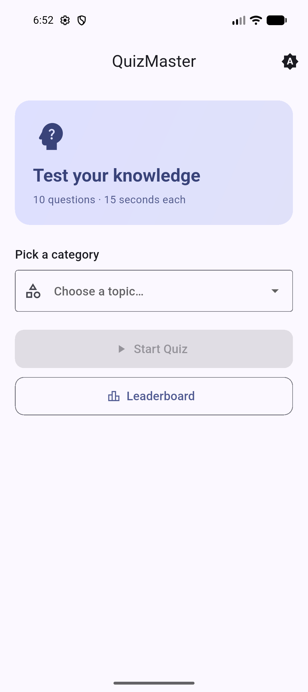
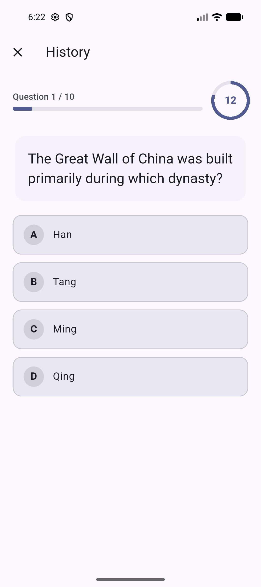
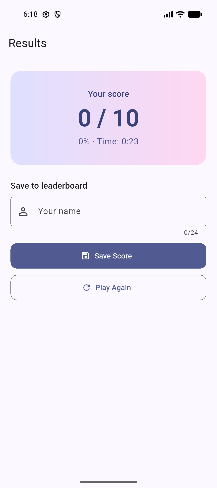
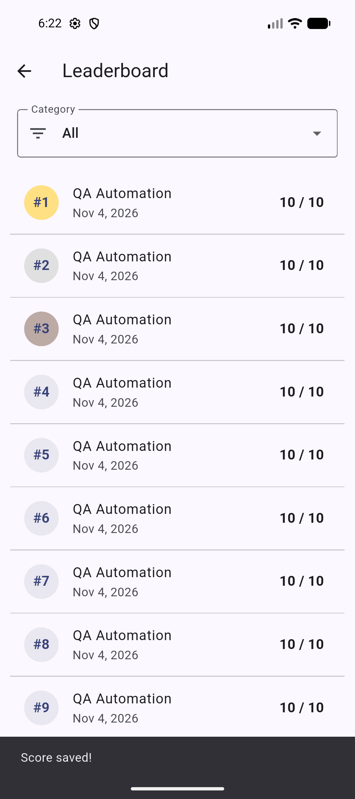

# QuizMaster Android Mobile Automation

An Android mobile test automation portfolio project for **QuizMaster**, a Flutter-based quiz application. Built with Python, Appium, and Pytest to automate and validate key application flows on Android.

The project demonstrates mobile UI automation, Page Object Model (POM) architecture, test data validation, regression execution, and Continuous Integration (CI) using GitHub Actions.

**Application Under Test:** [QuizMaster](https://github.com/Kevinnnhub/quizmaster)

## Tech Stack

| Technology | Version / Purpose |
|---|---|
| Python | 3.14 |
| Pytest | 9.2.0 |
| Appium-Python-Client | 6.0.9 |
| Appium Server | 3.1.2 |
| UiAutomator2 Driver | 6.7.1 |
| Selenium WebDriver | Mobile UI interaction |
| Android Emulator | Android test environment |
| GitHub Actions | CI automation |

## Automated Test Coverage

The project currently contains **15 automated tests** covering the following application areas:

| Area | Test Scenarios |
|---|---|
| App Launch | Verify application launch and Home Screen availability |
| Category Selection | Select the History quiz category |
| Quiz Initialization | Start a quiz and verify the initial question |
| Answer Selection | Select answers and validate UI feedback |
| Question Progression | Verify progression between questions |
| Answer Validation | Validate answers against the application's question dataset |
| Timer | Verify countdown behavior and timer expiration |
| Quiz Completion | Complete a quiz and verify the Results Screen |
| Score Calculation | Validate the final quiz score |
| Quiz State | Verify state reset when starting a new quiz |
| Replay | Start another quiz using the Play Again action |
| Leaderboard | Save a quiz score and verify the leaderboard entry |

## Framework Architecture

This project follows the **Page Object Model (POM)** design pattern to separate test scenarios from page interactions and improve maintainability.

- **Page Object Model:** Organizes page-specific locators and interactions into reusable page classes.
- **Base Page:** Centralizes common UI actions and explicit wait behavior.
- **Data-Driven Validation:** Uses the application's question dataset to validate correct answers.
- **Explicit Waits:** Waits for relevant UI elements and application state changes.
- **Independent Test Scenarios:** Organizes automated checks into separate test cases.

## Project Structure

```text
QuizMaster-Mobile-Automation/
|-- .github/
|   |-- scripts/
|   |   |-- run-android-tests.sh
|   |-- workflows/
|       |-- android-automation.yml
|-- config/
|   |-- settings.py
|-- pages/
|   |-- __init__.py
|   |-- base_page.py
|   |-- home_page.py
|   |-- quiz_page.py
|   |-- results_page.py
|-- reports/
|   |-- .gitkeep
|-- screenshots/
|   |-- 01-home-screen.png
|   |-- 02-quiz-screen.png
|   |-- 03-results-screen.png
|   |-- 04-leaderboard.png
|-- test_data/
|   |-- .gitkeep
|-- tests/
|   |-- test_answer_key.py
|   |-- test_answer_selection.py
|   |-- test_app_launch.py
|   |-- test_category_selection.py
|   |-- test_play_again.py
|   |-- test_question_progression.py
|   |-- test_quiz_answer_key.py
|   |-- test_quiz_completion.py
|   |-- test_quiz_full_answer_key.py
|   |-- test_quiz_score_calculation.py
|   |-- test_quiz_state_reset.py
|   |-- test_quiz_timer.py
|   |-- test_quiz_timer_expiration.py
|   |-- test_save_quiz_score.py
|   |-- test_start_quiz.py
|-- utils/
|   |-- answer_key.py
|-- conftest.py
|-- pytest.ini
|-- requirements.txt
|-- .gitattributes
|-- .gitignore
|-- README.md
```

## Prerequisites

Make sure the following tools are installed and configured:

- Python 3.14
- Node.js and npm
- Java JDK 17
- Android SDK and Android Emulator
- Android Debug Bridge (ADB)
- Appium Server
- Appium UiAutomator2 driver

The project was developed and tested locally on Windows using an Android emulator.

## Setup and Installation

### 1. Clone the repository

```bash
git clone https://github.com/alifdev/quizmaster-mobile-automation.git
cd quizmaster-mobile-automation
```

### 2. Create and activate a virtual environment

```powershell
python -m venv .venv
.\.venv\Scripts\Activate.ps1
```

### 3. Install Python dependencies

```bash
pip install -r requirements.txt
```

### 4. Install Appium

Install the required Appium version:

```bash
npm install -g appium@3.1.2
```

Install the UiAutomator2 driver:

```bash
appium driver install uiautomator2@6.7.1
```

### 5. Prepare the Android emulator and application

Start an Android emulator and verify that it is detected:

```bash
adb devices
```

Download the QuizMaster APK from the [original application repository](https://github.com/Kevinnnhub/quizmaster), then install it:

```bash
adb install -r app-release.apk
```

The current configuration uses:

- Device UDID: `emulator-5554`
- Application package: `com.example.quizmaster`
- Application activity: `.MainActivity`

Update `config/settings.py` if your emulator or application configuration is different.

### 6. Prepare the test dataset

The question dataset belongs to the original QuizMaster application repository and is not redistributed in this automation repository.

Download the dataset from the original source:

[QuizMaster questions.json](https://raw.githubusercontent.com/Kevinnnhub/quizmaster/main/assets/questions.json)

On Windows PowerShell:

```powershell
Invoke-WebRequest `
  -Uri "https://raw.githubusercontent.com/Kevinnnhub/quizmaster/main/assets/questions.json" `
  -OutFile "test_data/questions.json"
```

The expected file location is:

```text
test_data/questions.json
```

The `AnswerKey` utility reads this local dataset to validate expected correct answers during automated tests.

### 7. Start the Appium server

Open a separate terminal and run:

```bash
appium --address 127.0.0.1 --port 4723
```

### 8. Run the automated tests

From the project root directory:

```bash
pytest -v
```

For a shorter failure report:

```bash
pytest -v --tb=short
```

To generate HTML and JUnit XML reports:

```bash
pytest -v --html=reports/pytest-report.html --self-contained-html --junitxml=reports/junit-results.xml
```

## Test Execution Results

### Local Regression Execution

Latest full regression execution:

| Metric | Result |
|---|---:|
| Total Tests | 15 |
| Passed | 15 |
| Failed | 0 |
| Execution Time | 6 minutes 36 seconds |

**Result: 15/15 tests passed locally.**

### GitHub Actions CI

The automated test suite is integrated with GitHub Actions to execute mobile UI regression tests in a GitHub-hosted environment.

| Configuration | Details |
|---|---|
| CI Platform | GitHub Actions |
| Runner | GitHub-hosted Ubuntu |
| Android Emulator | API 35 |
| Automation Framework | Appium + Pytest |
| Test Execution | Automated |
| Latest Verified Result | 15 passed, 0 failed |

The CI workflow performs the following steps:

1. Checks out the repository.
2. Sets up Python, Java, and Node.js.
3. Installs Python dependencies, Appium, and UiAutomator2.
4. Downloads the application APK and test dataset.
5. Starts an Android emulator.
6. Installs the application and starts the Appium server.
7. Executes the automated test suite.
8. Uploads test reports and available execution evidence as GitHub Actions artifacts.

HTML reports, JUnit XML results, screenshots, and diagnostic logs are configured as CI artifacts for further inspection.

[View GitHub Actions Workflow](https://github.com/alifdev/quizmaster-mobile-automation/actions/workflows/android-automation.yml)

## Application Screenshots

### Home Screen



### Quiz Screen



### Results Screen



### Leaderboard



## Disclaimer

This repository contains an independent mobile automation test framework. QuizMaster is a separate application used as the system under test. All application source code, product names, and related assets belong to their respective owners.